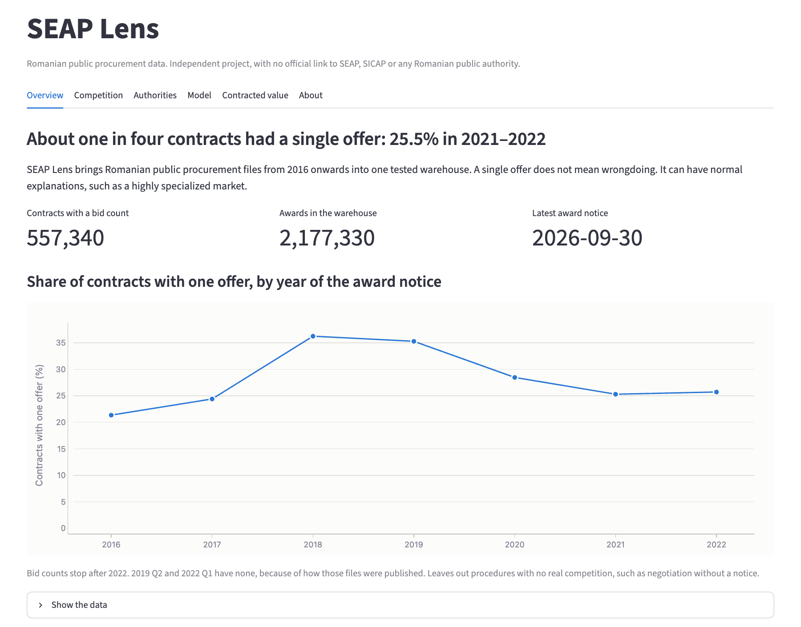
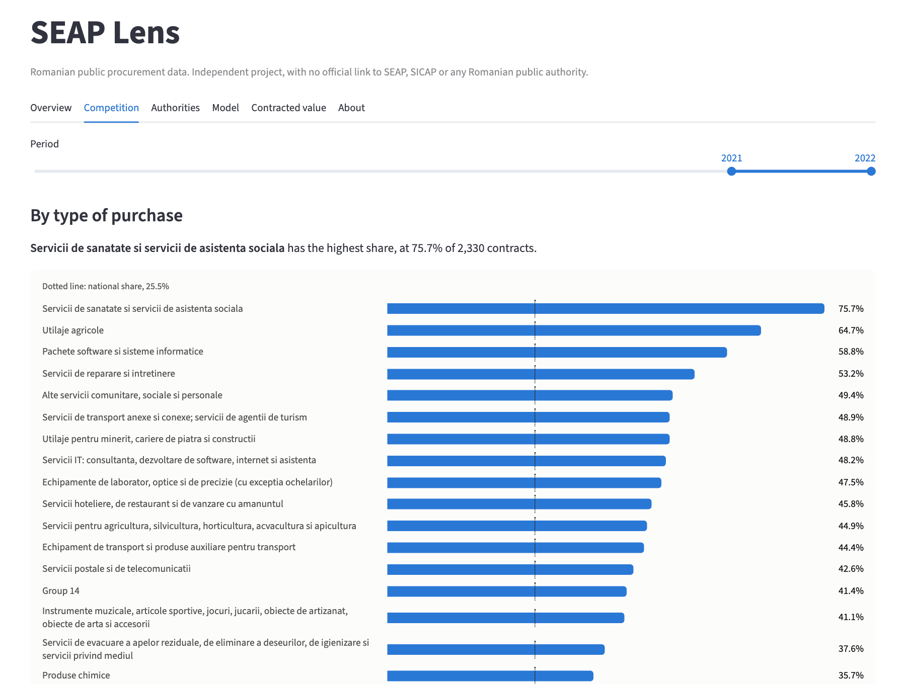
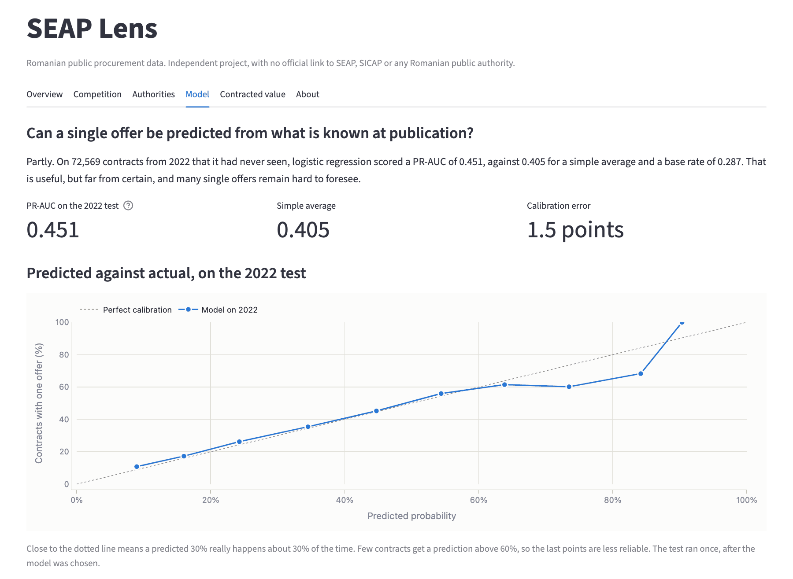
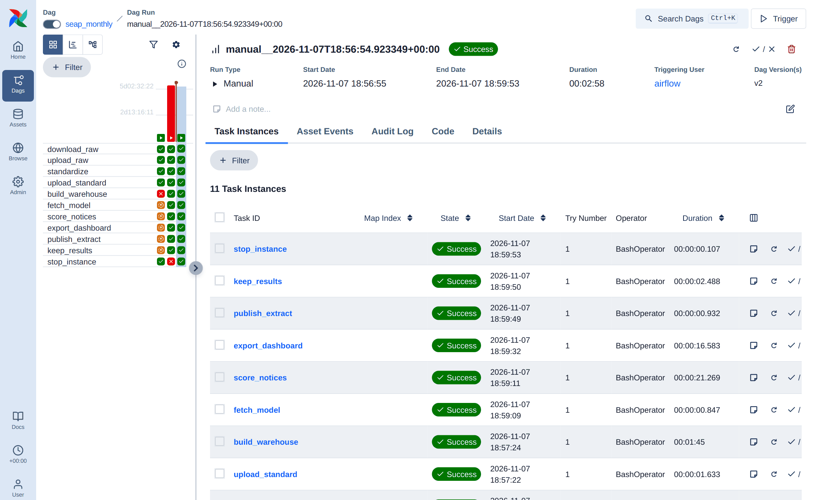
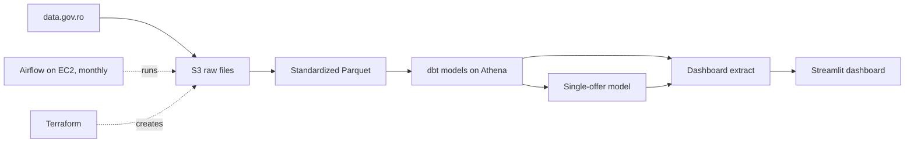

# SEAP Lens

A data warehouse, public dashboard and ML model built on Romanian public procurement data from SEAP/SICAP.

**This is an independent project, with no official link to SEAP, SICAP or any Romanian public authority.**

**Live dashboard: [seap-lens.streamlit.app](https://seap-lens.streamlit.app/)**. It sleeps when nobody has visited for a while, so it may ask you to wake it up, which takes about a minute.



<details>
<summary>More screens</summary>

Single-offer share by type of purchase, with the national share as a reference:



The model on the 2022 test, which ran only once, with predicted rates against actual rates:



A monthly run in Airflow on EC2, where every step from download to export passed in under 3 minutes:



</details>

## Findings

Shares count contracts with a bid count, leaving out procedures with no real competition. A single offer does not mean wrongdoing: it can come from a highly specialized market.

- **About one in four contracts got a single offer in 2021–2022:** 25.5%, after a peak of 36.2% in 2018. Bid counts stop after 2022, so later years can't be measured.
- **Some types of purchase stand out.** Health and social care services reached 75.7% of 2,330 contracts in 2021–2022, against 12.3% for clothing and footwear. One large procedure can have many contracts, so a high share can come from a few procedures.
- **Counties range from 16.2% to 40.6%,** from Olt to Salaj. The gap also reflects what each county buys.
- **A single offer is partly predictable at publication.** On 2022 contracts the model had never seen, it reached a PR-AUC of 0.451, against 0.405 for a simple average and a base rate of 0.287.
- **The published data needs care.** One file is truncated, one quarter is a copy of the next, formats change between files, and 7.7% of republished contracts change value. See the [validation report](docs/data-validation.md).

## How it works



- **Standardization** reads 80 files in changing formats, dates and encodings into one schema, and sets aside the rows it rejects.
- **dbt** keeps only the latest version of republished contracts and builds facts, dimensions and dashboard tables, with data tests. The same models run on DuckDB locally and on Athena in the cloud.
- **The model** uses only what is known when a notice is published, and a time split that keeps each procedure on one side.
- **Airflow** runs on an EC2 instance that starts on the 2nd of each month and stops after the run. Terraform creates everything, with no open ports and budget alerts.
- **The dashboard** reads a small extract outside AWS, so it stays online when the cloud resources are off.

## Status

The data has been validated across all files from 2016 to 2026 Q3, and the dashboard is public. The model is trained and tested. The pipeline runs monthly on AWS, on S3, Athena and Airflow on EC2, and its results match the local DuckDB warehouse.

- [Design spec](docs/superpowers/specs/2026-10-30-seap-lens-design.md)
- [Data validation report](docs/data-validation.md)
- [Model results](docs/model-results.md)
- [AWS runbook](docs/aws-setup.md)
- [Data model documentation](https://ionutcal.github.io/seap-lens/), with every table, column and test, and the lineage graph

## Run locally

```bash
python3.12 -m venv .venv
.venv/bin/pip install -r requirements.txt
.venv/bin/python -m pytest
```

Build the warehouse on the full data, which downloads about 2.4 GB:

```bash
.venv/bin/python -m scripts.download_raw
.venv/bin/python -m scripts.standardize_all
(cd dbt && ../.venv/bin/dbt build --profiles-dir .)
.venv/bin/python -m scripts.warehouse_summary
```

Run the dashboard, which reads the extract committed in `dashboard/data`:

```bash
.venv/bin/streamlit run dashboard/app.py
```

After rebuilding the warehouse, refresh that extract with `.venv/bin/python -m scripts.export_dashboard`.

Train and test the model, on macOS after `brew install libomp`. The test runs only once, and its result is committed:

```bash
.venv/bin/pip install -r requirements-ml.txt
.venv/bin/python -m scripts.train_model validate
.venv/bin/python -m scripts.train_model test
.venv/bin/python -m scripts.train_model score
```

Files that can't be used as published are listed in `src/catalog.py`, and the reasons are in the [validation report](docs/data-validation.md).

## Data

Source: [data.gov.ro](https://data.gov.ro), published by the Autoritatea pentru Digitalizarea României. Datasets from 2016–2020 are under OGL-ROU-1.0 and those from 2021 under [CC BY 4.0](https://creativecommons.org/licenses/by/4.0/). The figures here are derived from that data.
